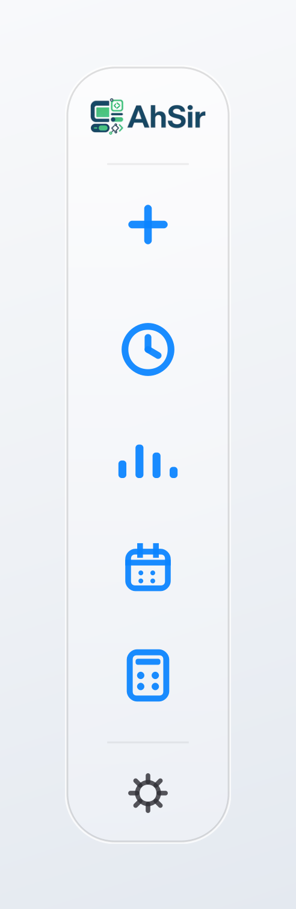
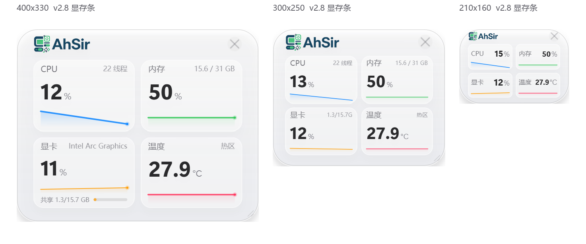
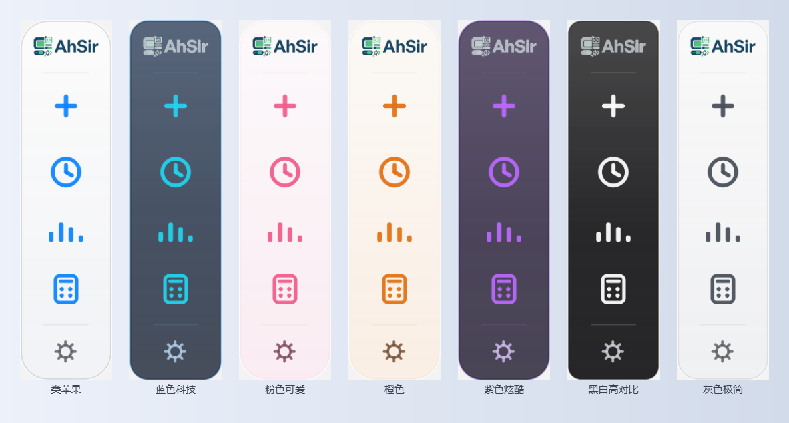
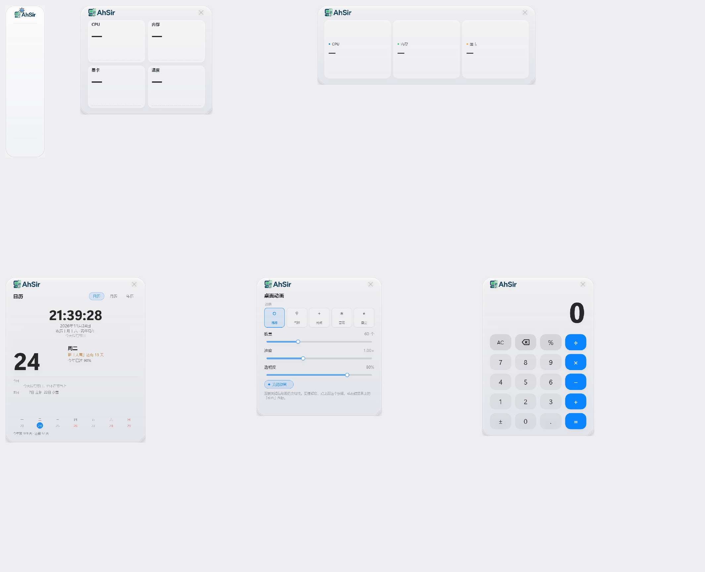

# 桌面多功能工具 · MultiTool

一条贴在屏幕边缘的竖长条，按需唤起六个桌面小组件：计时器、系统监控、系统信息、桌面动画、日历、计算器。半透明玻璃卡片风格，**7 套主题**可换（v2.9），界面支持**简体 / 繁體 / English**（v3.0）。

Windows 10 / 11 x64 · 免安装 · 不联网 · 无后台服务

  

## 下载

[**→ 前往 Releases 下载最新版**](../../releases/latest)

每次更新都会发一个 Release，里面有：

- `MultiTool-v3.0.0-win64.exe` —— 单文件主程序，双击即用
- `MultiTool-v3.0.0-win64-manual.txt` —— 安装、操作、常见问题（记事本直接打开）

## 第一次运行

1. 双击 exe。首次启动约 2–3 秒（需解压 Qt 运行库），之后很快。
2. 屏幕右侧出现竖条，1 秒后自动收成一条 12px 细条，鼠标移上去展开。
3. 点竖条上的蓝色 **＋** 选组件，可同时开多个。
4. 退出：竖条最下方齿轮 → 退出，或通知区域图标右键 → 退出。

> 程序没有代码签名，Windows 可能提示「已保护你的电脑」：点「更多信息」→「仍要运行」。

详细操作（拖拽、缩放、贴边收缩、各组件用法、常见问题）见 **[使用说明](使用说明.md)**。

## 组件

| 组件 | 内容 |
|---|---|
| 计时器 | 正计时 `00:00:00` → `99:59:59`，播放 / 暂停 / 复位 |
| 系统监控 | CPU、内存、显卡、温度，各带 4 分钟走势线；显卡块带显存读数 |
| 系统信息 | CPU 型号、内存型号与容量、显卡型号（多卡全列） |
| 桌面动画 | 泡泡 / 气球 / 光点 / 雪花 / 星尘，画在图标之上、窗口之下，鼠标可穿透 |
| 日历 | 阳历 + 农历 + 时间，日历 / 月历 / 年历三视图，节日节气闪烁 |
| 计算器 | 四则运算、百分比、正负号、键盘输入 |

## 主题

齿轮 → 主题（或通知区域图标右键 / 组件卡片右键），7 套配色即时切换，整套界面一起变，选择记忆到下次启动。

  

类苹果（默认）· 蓝色科技 · 粉色可爱 · 橙色 · 紫色炫酷 · 黑白高对比 · 灰色极简。
详见 [使用说明 · 三、主题](使用说明.md)。

## 语言

齿轮 → 语言（或通知区域图标右键 / 组件卡片右键），简体中文 / 繁體中文 / English 三档，切换即时生效，选择记到下次启动。

  

首次启动按系统语言猜一次：港台系统 → 繁體，其它中文 → 简体，非中文系统 → English。之后以手动选的为准。
详见 [使用说明 · 四、语言](使用说明.md)。

## 更新

只在这个页面的 **Releases** 里发布，仓库本身不放安装包。想收更新通知，点右上角 **Watch → Custom → Releases**。

## 反馈

装不上、报错、想要的功能，直接开 [Issue](../../issues) 说一声。附带「系统版本 + 报错截图」能省很多来回。

## 说明

本仓库仅用于分发安装包，不包含源代码。

## 许可

[MIT](LICENSE) —— 可自由使用、修改、再分发。
