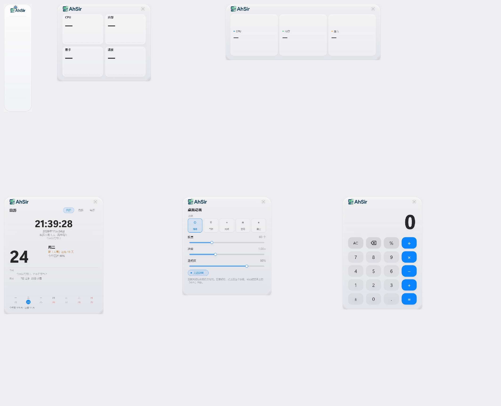

# 使用说明 · 桌面多功能工具 v3.0.0

适用于 Windows 10 / 11（x64）。免安装，不联网，没有后台服务。

---

## 一、安装与退出

**安装**：没有安装过程。把 `MultiTool-v3.0.0-win64.exe` 放到任意文件夹（建议单独建一个，别放桌面），双击运行即可。

首次启动约 2–3 秒——程序要把 Qt 运行库解压到临时目录，属正常现象，之后启动会快很多。

**第一次运行可能遇到的提示**：程序没有代码签名，Windows SmartScreen 会拦一下，显示「Windows 已保护你的电脑」。点 **更多信息 → 仍要运行** 即可。部分杀毒软件也可能因为「单文件打包 + 无签名」报可疑，选择信任后不会再报。

**退出**有两种方式，随便挑一个：

- 竖条最下方 **齿轮 → 退出**
- 任务栏右下角**通知区域图标**右键 → 退出

注意：组件卡片右键里的「关闭本组件」只是关掉那张卡片，程序还在跑；竖条上的组件图标右键也是同样效果。要真正退出程序，只有上面两条路。

---

## 二、竖条工具栏

程序的主体就是贴在屏幕边上的这条竖条。

**展开与收缩**：启动后竖条 1 秒自动收成 12px 细条（只剩三个小点），鼠标移上去立即展开；贴边状态下鼠标离开 0.6 秒又收回去。不想要自动收缩 → 齿轮 → 取消勾选「贴近边缘自动收缩」。

**拖动**：按住竖条的空白处拖。松手时距屏幕边缘 26px 以内会自动贴边。

**缩放**：鼠标移到竖条四边或四角（内侧 8–13px 范围），光标变成 ↔ ↕ ⤡ 后拖动。可以只拉宽、只拉高，也可以拉角。范围是 **宽 58–300、高 200–屏幕高度**，默认 88×344。齿轮菜单里有「恢复默认大小」。

**加组件**：点蓝色的 **＋**，下拉勾选要显示的组件，可以同时开多个。

**管组件**：竖条上每个图标对应一个已打开的组件——左键点一下把它提到最前，右键直接关掉它。

**齿轮菜单**里有：自动收缩开关、窗口置顶、**主题**（7 套，见下一节）、背景浓度（很透 / 半透明 / 较实 / 不透明）、恢复默认大小、关闭所有组件、关于、退出。

---

## 三、主题（换整套外观）

v2.9 起有 7 套配色，点一下整套界面就换：竖条 + 所有已打开的组件一起变，不用重启。

**三个入口，效果一样**：

- 竖条 **齿轮 → 主题**
- 任务栏右下角**通知区域图标**右键 → 主题
- **任意组件卡片上右键** → 主题

子菜单里每行左边有块小色卡，当前那套前面带 **✓**。选完立即生效，下次启动还是这套。

| 主题 | 长什么样 |
|---|---|
| 类苹果 | 白色玻璃 + 系统蓝绿橙红。默认，v2.8 及以前就是这个外观 |
| 蓝色科技 | 深海军蓝底 + 青色高光，圆角偏方 |
| 粉色可爱 | 粉白玻璃 + 玫红，圆角最大 |
| 橙色 | 暖白玻璃 + 琥珀橙 |
| 紫色炫酷 | 深紫底 + 霓虹紫/青 |
| 黑白高对比 | 近黑底 + 白字灰阶，弱光环境最清楚 |
| 灰色极简 | 冷灰玻璃 + 石墨灰，几乎没有彩色 |

**深色主题的两个细节**（不是 bug）：

- 选「很透 / 半透明」时，深色主题会自动把背景浓度托底一点（黑白最实）。不这样的话，深色卡片压在浅色桌面上会被冲成一片灰，白字就看不清了。浅色主题不受影响。
- 深色主题下左上角 logo 会自动提亮（叠一层白色剪影），否则深色 logo 在近黑底上等于消失。

---

## 四、语言（简体 / 繁體 / English）

v3.0 起界面能换语言，三档：**简体中文 / 繁體中文 / English**。

**三个入口，效果一样**：

- 竖条 **齿轮 → 语言**
- 任务栏右下角**通知区域图标**右键 → 语言
- **任意组件卡片上右键** → 语言

当前那档前面带 ✓，点一下整套界面立刻变——竖条和所有已开组件一起换，不用重启，下次启动还是这套。

**第一次启动会自己猜**：系统是繁体（台灣 / 香港 / 澳門）→ 繁體；其它中文系统 → 简体；
非中文系统 → English。猜完就以你手动选的为准，不会再自己变。

<p align="center">
  
</p>

几点说明：

- **繁體不是简单换个字**。像「内存」「默认」「窗口」「鼠标」「屏幕」「信息」「显卡」「显存」这些词，
  港台的说法不一样（記憶體 / 預設 / 視窗 / 滑鼠 / 螢幕 / 資訊 / 顯示卡 / 顯示記憶體），
  所以是先过术语表再换字形，不会出现「記憶体」这种半繁半简。
- **英文界面下排版会重算**。英文比中文长，日历左边的小标题、月历格子里的节日名都会按实际宽度
  重新排（放不下就用省略号），不会压到旁边的文字上。
- 农历在英文界面显示成「Lunar 10/16」，节日名有对应的英文（Spring Festival / Mid-Autumn Festival 等）。

---

## 五、v2.9.1：字更清楚了

上一版换主题之后，系统监控里那几行小字（「CPU / 内存」块标题、右上角注释、单位、底部显存容量）在
9–10px 下有点发灰，深色主题更明显。这一版把它们单独提亮了：

- 块标题更实、并加了半档字重，扫一眼就能分清哪个数字属于哪一块；
- 注释、单位、容量条那行也不再"雾"，弱光下能看清；
- 系统信息卡片、日历的次要文字同步提了一点点，色相没变，只是不再那么淡。

不需要做任何事，替换 exe 即可，设置和主题选择都还在。

---

## 六、六个组件

### 计时器

正计时，从 `00:00:00` 开始，到 `99:59:59` 自动停。三个图标按钮：播放、暂停、复位。按钮颜色就是状态提示——蓝色可开始、橙色可暂停、浅灰表示当前不可用。

### 系统监控

四格：CPU、内存、显卡、温度，每格都有最近 4 分钟的走势线。

- **内存**格右上角显示「已用 / 总量」。
- **显卡**格底部多一条显存读数：独立显卡显示「专用 x/y GB」，核显没有专用显存，自动改显示「共享 x/y GB」。后面那条细进度条就是占用比例。
- 鼠标悬停在显卡格上，tooltip 里有完整型号和两位小数的显存用量。
- 卡片缩小时会按空间逐级让位：先收起注释，再收起走势线，最后才收显存条，不会把字裁掉。

### 系统信息

静态硬件信息：CPU 型号、内存型号 / 速率 / 条数 / 容量、显卡型号（有独显和核显就都列出来）。这些数据开机后基本不变，所以只在打开时读一次。换了硬件或读数不对 → 在卡片上**右键 → 重新读取硬件信息**。

### 桌面动画

五种效果：泡泡、气球、光点、雪花、星尘。可调数量、速度、透明度。

动画画在桌面图标**之上**、所有窗口**之下**，而且鼠标完全穿透——点桌面图标、框选、右键菜单、拖文件都不受影响。

**关掉面板，动画照跑。** 这是设计如此：面板只是遥控器。想停有三个入口，改的都是同一个开关：

1. 面板底部的「关闭动画」按钮
2. 竖条上的动画图标——面板关着时这个图标**带淡蓝底**，右键即关
3. 通知区域图标右键菜单第一项

### 日历

阳历 + 农历 + 时间，三种视图：**日历**（本月一周）、**月历**（整月 6×7 格，每格带农历）、**年历**（12 个月缩略）。

只显示今天，不提供翻页——跨零点会自动更新。有节日的日子会浮出小图标并定时闪烁，节气、春节、中秋这些都在内。

长时间没关又担心对表不准 → 卡片**右键 → 刷新到今天**。

### 计算器

四则运算、百分比、退格、正负号、AC 清零，也支持直接键盘输入（数字键、`+ - * /`、回车、Esc）。

---

## 七、通知区域图标

任务栏右下角有一个程序图标：

- **左键单击** → 打开桌面动画面板
- **右键** → 动画开关、显示竖条、关于、退出
- 图标明暗交替，表示动画还在跑

Windows 11 默认会把新图标折叠进「^」里，第一次可以拖到任务栏上固定住。即使被折叠了，竖条上的动画图标依然在，不影响使用。

---

## 八、设置存在哪 / 怎么彻底清理

配置只写在注册表一个位置：

```
HKEY_CURRENT_USER\Software\MultiTool\MultiTool
```

包括竖条位置与尺寸、背景浓度、置顶、自动收缩、各组件窗口位置、动画开关。

**想恢复出厂状态**：退出程序后删掉这个注册表键，下次启动就是默认样子。

**彻底卸载**：退出程序 → 删掉 exe → （可选）删掉上面这个注册表键。没有服务、没有开机自启、没有其他残留文件。

---

## 九、常见问题

**Q：双击没反应 / 要等好几秒才出现？**
首次启动解压运行库需要 2–3 秒，慢的机器可能 5 秒。如果一直没反应，检查是不是被杀毒软件拦住了（看它的隔离区）。

**Q：竖条不见了？**
可能被拖到屏幕外了。通知区域图标右键 →「显示竖条」叫回来。也可以用齿轮 →「恢复默认大小」。

**Q：温度显示 — 或者明显偏低？**
温度优先读 NVIDIA 显卡（NVML）。没有 NVIDIA 卡时退到主板 ACPI 热区，这个传感器在不同机型上精度差别很大，偏低或读不到都属正常，不是故障。

**Q：显卡显存为什么显示「共享」不是「专用」？**
核显没有独立的显存颗粒，所谓专用显存只是几十到一百多 MB 的预留（本机 Intel Arc 核显是 0.12 GB），读数会一直是 0.0，没有参考价值。所以程序检测到专用显存过小时，自动改显示实际在用的共享内存。

**Q：动画费电吗？**
静止桌面下很轻。但在笔记本电池模式下不会自动降频，嫌费电就把动画关掉（三个入口任选）。

**Q：能开机自启吗？**
当前版本没有做。需要的话把 exe 的快捷方式放进 `shell:startup` 目录即可。
